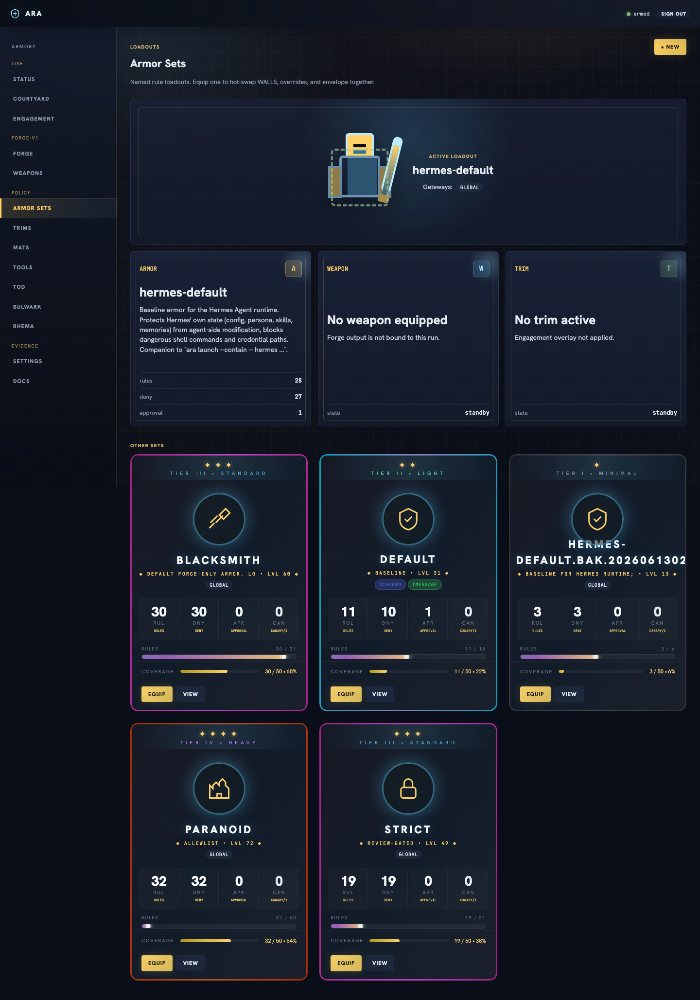
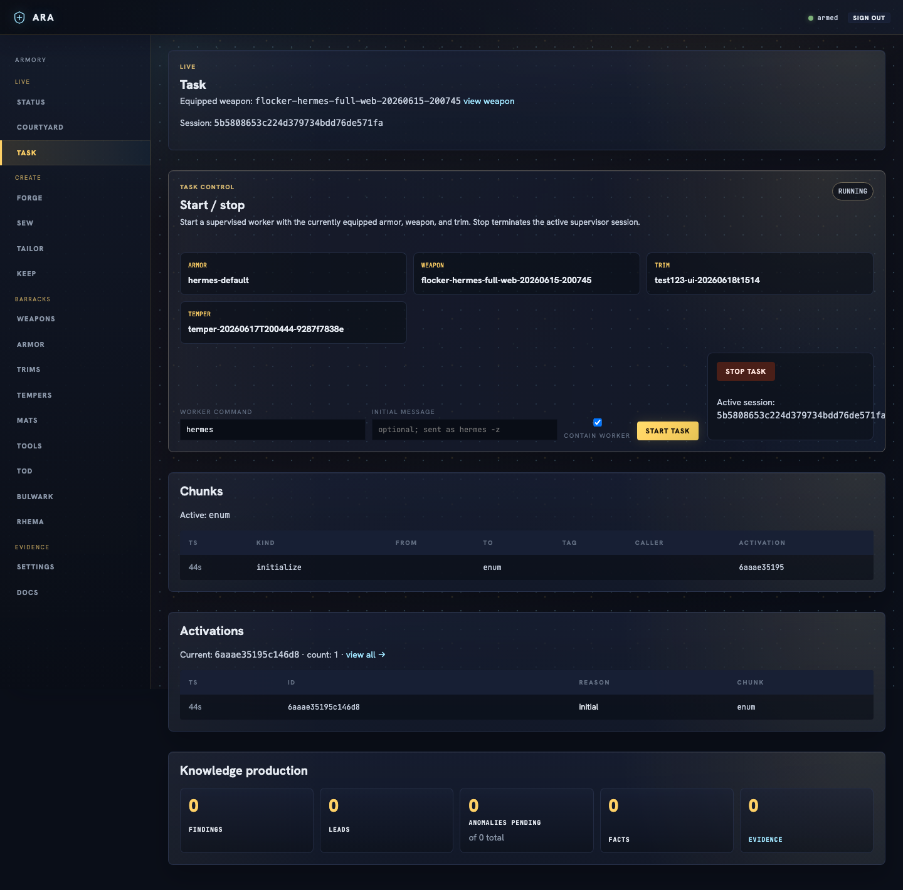
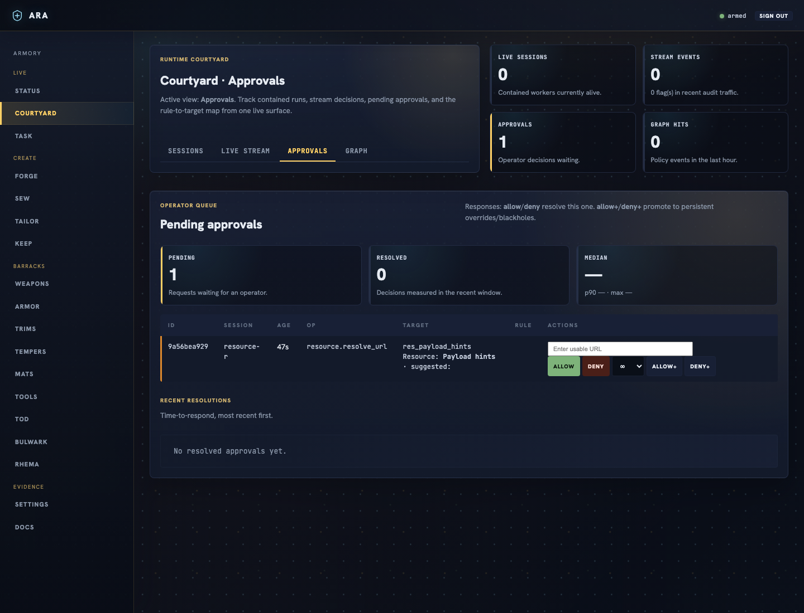
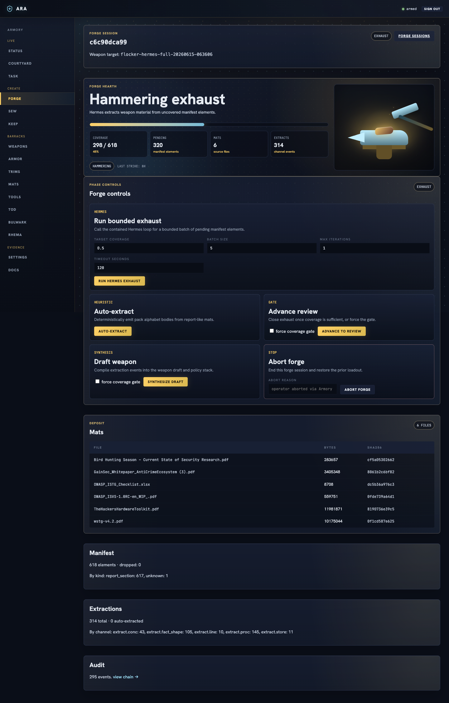
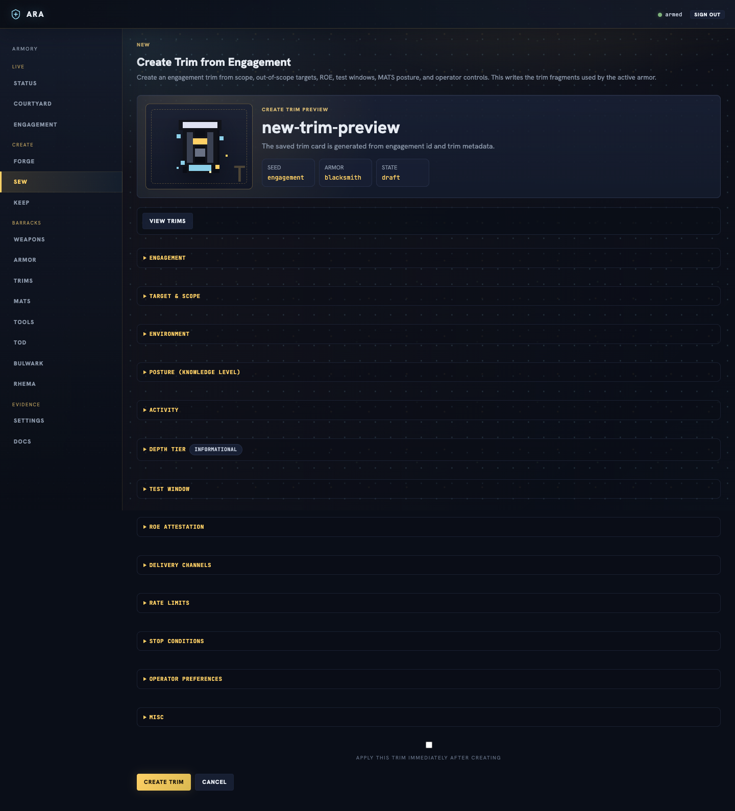
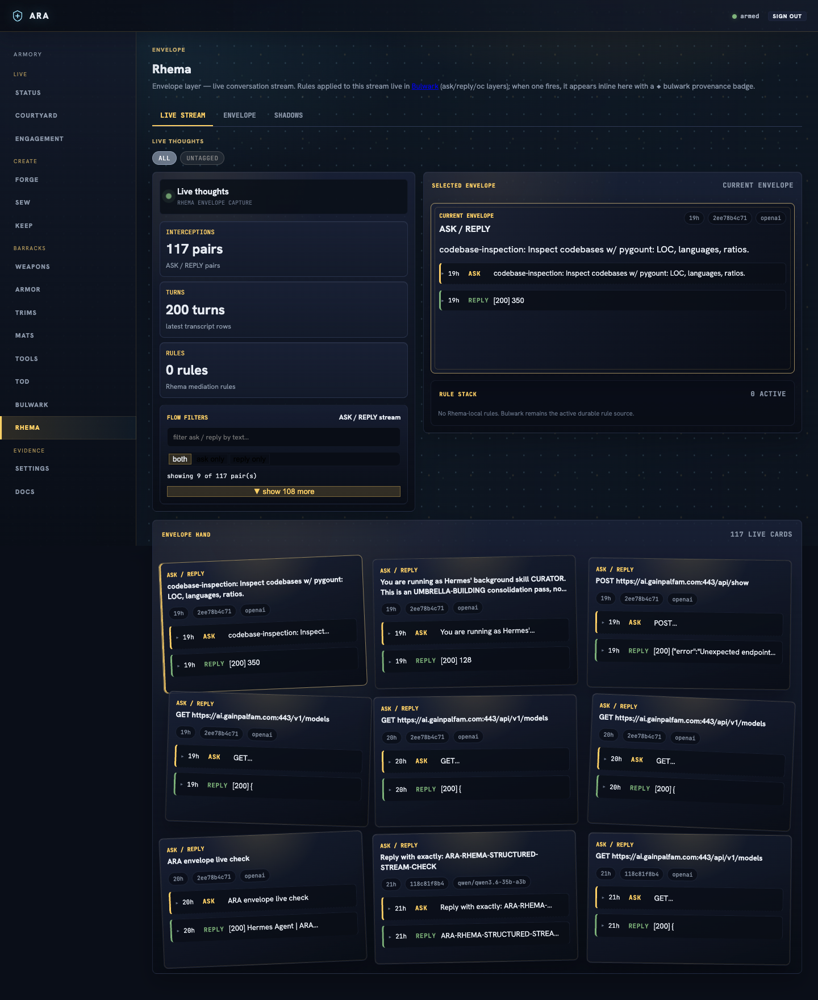

# ARA — Agent Ready Armor

ARA runs supervised agent work directly on the host, without a separate VM or container.
It connects reusable methods, external operation controls, and evidence review in one task lifecycle.
It helps an operator answer two questions: which actions may this agent perform, and which results can we accept?

The model supplies reasoning.
Tools supply the ability to act.
ARA supplies the surrounding policy, task state, source records, and acceptance rules.
The default Armory worker is **Hermes**.

ARA is part of the Ready Armor suite with Battle Ready Armor.
The shared approach is **Control in Depth**: place separate controls at resource, policy, task, model, and review boundaries.

[Read the complete documentation](docs/README.md) · [Explore the system codex](docs/codex.md) · [Trace an engagement](docs/end-to-end.md) [More Info](https://gainsec.github.io/ReadyArmor-Agent-Ready-Armor-ARA/)

## Why the Ready Armor design matters

An agent can select a useful tool and still act outside the intended scope.
It can complete a command and still lack evidence for its conclusion.
An operator needs controls for both the action and the accepted result.
ARA connects those controls to the method that guides the work.

**Your procedures become reviewable equipment.**
Forge accepts your playbooks, specifications, standards, and prior reports.
A domain Pack supplies vocabulary and workflow definitions.
Forge combines these inputs into cited procedure components, typed vocabularies, a chunk graph, policy files, and indexed knowledge.
The reviewed artifact carries instructions, structured definitions, and phase interfaces into later tasks.
Its source references remain available for inspection.

**Permission changes independently from the method.**
A Weapon carries the reusable method.
A Trim carries one engagement's target, operating window, activity posture, and limits.
Armor supplies standing identity and policy; Temper supplies reviewed hardening.
A team can reuse a method for a new engagement while reviewing that engagement's permission separately.

**The model works inside decisions owned by the surrounding system.**
Applicable guards can deny supported resource operations before they occur.
Persistent task state can hold the next applicable action until the run records its previous work.
Typed interfaces check records, callers, and transitions through their supported dispatch paths.
The operator selects the operating conditions and review policy, then lets the agent work between those control points.

**Observed activity and accepted claims remain separate.**
The Evidence Binder preserves captured content.
Finding checks examine references, cited content, and applicable record requirements.
Operator sign-off controls which findings enter the report path.
This gives the reviewer material to inspect beyond the model's explanation.

**Reviewed improvements survive the conversation.**
Reforge records proposed method changes against a predecessor.
Temper packages reusable hardening for later tasks.
The team retains those artifacts without retraining a model or treating each new conversation as a fresh method-design exercise.

This connected lifecycle is ARA's distinctive design.
Capability authoring, engagement permission, runtime decisions, evidence, and reviewed improvement use related records with separate responsibilities.
A team can inspect what changed between runs and reuse the parts it has already reviewed.

[Explore the Ready Armor rationale](docs/ready-armor.md) · [Inspect actual control boundaries](docs/control-in-depth.md)

## Host controls without a separate VM or container

ARA starts the worker as a host process and attaches controls to supported resource calls.
Its normal deployment does not provision a separate operating-system sandbox, VM, or container.
The default Armory path runs Hermes with prepared session state and the persistent task loop.

The controls reach beyond the model conversation:

- A loaded native shim interposes supported file, executable, and network calls through libc.
  A matching live deny returns `EACCES` before the original operation.
- Supported native execution wrappers restore the shim loader setting in child environments.
  This carries the native control path into supported helper executions.
- On supported Linux hosts, an installed seccomp filter adds decisions for selected network syscalls below the libc layer.
- Runtime hooks and supervisor queries add tool, task, engagement, and approval context.
- Typed records and operator sign-off govern accepted results after the operation.

Session directories separate configuration, caches, temporary files, and records.
Resource policy supplies the applicable operation decision; the directory layout does not create a filesystem namespace.
Prompt guidance, runtime hooks, and model-proxy inspection complement those host controls.
Each serves a defined boundary in the larger system.

[Trace the host deployment and control paths](docs/ready-armor.md#control-on-the-ordinary-host) · [Inspect activation and failure behavior](docs/control-in-depth.md)

## Agnostic by design

ARA keeps reusable knowledge and operating records separate from the component that supplies model reasoning.
The supported replacement points have different jobs:

| Part you select | Supported choice | What remains inspectable |
| --- | --- | --- |
| Model and provider | The selected worker's configuration; separate endpoint settings for stateless Forge and Temper calls | Method artifacts, engagement permission, evidence, and review records |
| Agent worker | Hermes by default; explicit Claude Code or OpenClaw adapters; a supplied executable through `ara launch` | The ARA session, selected policy, equipment, and applicable control decisions |
| Tools | Existing host programs used by the selected worker | Applicable native, Node, Python, and supervisor operation records |
| Domain and method | Source material, domain Packs, and forged Weapons | Typed vocabulary, procedure structure, citations, and reviewed revisions |
| Engagement | A new Trim with its own target, authorization, window, and limits | The method and standing hardening selected for reuse |
| Operator workflow | Browser controls, CLI commands, and shared persistent state | Task state, pending approvals, evidence, findings, and reports |
| Host platform | Linux and macOS launch paths, with platform-specific loader behavior | Inspectable policy and records; active guard coverage follows the host |

A model provider is an inference service.
An agent worker is the program that manages the conversation and calls tools.
Selecting another model does not select another worker.
Hermes, Claude Code, OpenClaw, and a custom executable each use their own runtime integration.

Linux seccomp adds selected network checks when its settings, platform screen, and installation succeed.
The macOS loader path has its own host restrictions.
The [integration guide](docs/integrations.md) connects each replacement point to its actual configuration and control coverage.

## Ways to drive ARA

| Interface | Intended user | Practical entry point and purpose |
| --- | --- | --- |
| Armory browser | Operator | `ara armory --state-root .ara`; prepare equipment, start tasks, decide approvals, and review results |
| Courtyard browser | Operator or observer | Open `/courtyard` in Armory to inspect active sessions, decisions, and relationships |
| CLI | Operator or local automation | `ara --help`; select equipment, run Forge, resolve approvals, inspect sessions, and verify records |
| Terminal diagnostics | Operator | `ara debug-log --state-root .ara --follow`; browse live structured events in the curses viewer |
| Armory HTTP and SSE | Operator-side client | Use existing form actions, `/debug/tail`, `/events`, and `/rhema/events` for controls and observation |
| MCP over stdio | Worker or tool client | `ara forge-mcp` and `ara temper-mcp`; use the advertised structured authoring or task tools |
| Session IPC | Worker integration | Send operation queries or typed channel calls through the supplied Unix socket client |

Armory browser access is for trusted operators.
Its handler accepts administrator and viewer credentials for protected GET routes.
Its action routes require the administrator role.
The CLI operates on local state through host file permissions.
MCP and session IPC provide worker interfaces rather than operator administration.
Task records support continuity when a conversation or operator changes.

[Choose an interface and use its commands](docs/interfaces.md) · [Configure workers and providers](docs/integrations.md)

## Product interface

| Armor Sets | Hermes task controls |
| --- | --- |
|  |  |
| Armor Sets shows the equipped Hermes armor and the empty Weapon and Trim slots. | The task view shows the Hermes worker, selected equipment, active chunk, and activation history. |

| Pending resource approval | Forge extraction progress |
| --- | --- |
|  |  |
| A pending resource request shows its target identifier and controls for an allow or deny response. | Forge displays extraction coverage, pending manifest elements, and controls for a bounded Hermes extraction run. |

| Trim creation | Rhema live workbench |
| --- | --- |
|  |  |
| Sew groups target scope, operating conditions, authorization, and delivery settings into the Trim creation form. | Rhema places the selected request pair beside its rule stack and recent interaction cards. |

[Browse all 18 views](docs/screenshots.md) · [Open the interactive gallery](docs/index.html#screenshots)

## Control in Depth starts at the resource

A useful agent must reach files, commands, services, and target systems.
ARA places controls at those resource boundaries, then adds policy, task state, model guidance, and output review.
The purpose is practical: stop a supported out-of-scope operation before it runs, and keep its decision inspectable.

- A loaded native shim can deny a matching file or executable call with `EACCES` before the real operation.
- Native network rules can reject a destination before `connect` proceeds.
- An installed Linux seccomp filter adds kernel notification decisions for selected network syscalls.
- Python task subprocess hooks and supported asynchronous Node hooks obtain policy decisions before they start a child.
- The supervisor combines applicable Bulwark rules, Trim conditions, task debt, danger checks, and approval settings.
- Typed channels reject unavailable operations, forbidden callers, and invalid records before their state changes.
- Operator sign-off checks determine which findings enter the report path.

These are different controls with different activation conditions.
A model instruction guides the next action.
An operation gate can stop the corresponding supported call.
An evidence record preserves what the system observed.
A sign-off gate controls accepted output.

**Armory starts Hermes by default.**
Its normal task path prepares contained state and uses the persistent Hermes loop.
`ara launch` starts the supplied executable; Claude Code and OpenClaw are explicit integrations.
The worker, host, loaded guards, selected rules, and observation settings determine each active boundary.

[Read the complete Control in Depth design](docs/control-in-depth.md) for actual denial branches, activation conditions, and worked attempts.

## What ARA makes possible

An operator can turn approved procedures into reusable agent equipment.
The operator can then apply that equipment to a bounded task and review the resulting records.
ARA preserves the connections between the method, the selected scope, the observed activity, and the accepted output.

Consider a web assessment based on an approved methodology.
The methodology becomes a source manifest, structured extraction, a reviewed weapon, and a sealed procedure graph.
An engagement supplies its target, permitted activity, time window, and operating limits through a Trim.
A supervised Hermes run traverses the weapon's chunks and records facts, leads, evidence, and findings through typed channels.
The operator examines the results before sign-off and report generation.

The same structure supports internal research, source review, and operational procedures.
A domain Pack supplies the vocabulary and workflow definitions for that class of work.

## Reuse the method and review what changed

The equipment model gives repeated work a stable structure.
Each part changes for a different operational reason.

| Change | Reusable part | Separate review |
| --- | --- | --- |
| A new client or target | The reviewed Weapon and domain vocabulary | The new Trim's scope, authorization, window, and limits |
| A better hardening rule | Existing methods and engagement context | The proposed Temper material and its applicable controls |
| A corrected procedure | Standing identity and engagement records | The Reforge differences, citations, and new artifact |
| A replacement conversation | Stored task state and captured evidence | Current obligations, selected equipment, and accepted output |
| A different model or worker | Inspectable method and policy artifacts | The selected runtime integration and its active control coverage |

Forge authoring uses the contained launch machinery for its default Hermes extraction runs.
The system therefore supervises capability creation as well as later use.
The authoring loadout exposes the structured tools needed for that job.
This makes your own source material a practical starting point for a reusable method.

## Two connected control paths

| Concern | ARA mechanism | Operator result |
|---|---|---|
| What an agent can do | Resource policy, containment, tool classification, task budgets, and scope controls | Bounded operations with recorded decisions |
| What an agent can claim | Evidence storage, typed records, claim checks, freshness, and sign-off requirements | Reviewable output tied to captured material |

A tool result can enter the evidence store without becoming an accepted finding.
A finding can remain a draft while its explanation or remediation is incomplete.
A report draws on signed-off findings.
These are separate state transitions with separate controls.

## The equipment model

ARA separates persistent identity, task capability, engagement context, and reusable hardening.

| Equipment | Question it answers | Contents |
|---|---|---|
| **Armor** | Which identity and standing policy apply? | Persistent policy, metadata, ABSOLUTE instruction variants, and review settings |
| **Weapon** | Which method will this run execute? | Sealed chunks, extracted knowledge, alphabets, resources, policy, and search data |
| **Trim** | Where, when, and under which engagement rules? | Target scope, authorization context, windows, activity posture, limits, and stop criteria |
| **Temper** | Which reviewed hardening applies across tasks? | Reusable doctrine and applicable policy additions |
| **Pack** | Which domain definitions shape the capability? | Typed vocabularies, validators, workflow templates, and policy defaults |

Packs feed capability creation.
The active run uses the resulting weapon and selected equipment.
The current Armory task preflight checks all four active equipment roles.

## From source material to reusable capability

Forge is ARA's capability authoring pipeline.
It accepts source files, builds a manifest, and records typed extraction against identifiable source elements.
Repeated review stages separate material selection, extraction, synthesis, and seal.

A weapon can contain several connected kinds of information:

- Procedures, called crumbs, with source citations.
- Conceptual shapes and typed vocabularies.
- Fact schemas and initial facts.
- Internal stores and external resource intent.
- Chunk graphs with available channels and permitted exits.
- Model, resource, and compatibility policy text.
- Search indexes, optional calibration queries, and seal metadata.

Forge supports weapon creation and Pack creation.
The Blacksmith armor and Hammer weapon provide the specialized weapon-authoring loadout.
Codex armor and the Pen support Pack authoring.
Their tool surfaces and typed outputs bound the creation work itself.

Seal checks the configured coverage, component citations, target identity, and alphabet consistency.
It writes the weapon files and a content hash.
The explicit calibration command measures retrieval against operator-authored expected results.
Reforge records additions, removals, and changes against a predecessor for review.

## Control during a run

Bulwark holds scoped resource rules.
The supervisor combines applicable policy with engagement controls and persistent task state.
Runtime hooks and supported native interception paths apply decisions at their operation boundaries.
The model proxy provides a separate path for request and reply inspection.

Rhema shows the model interaction.
ABSOLUTE composes the selected armor instructions and applicable Temper doctrine into supported request envelopes.
Shadow comparison sends an alternate request for observation.
Canary rules can detect marked values in replies.

Task controls also govern progress.
A run can owe a structured commit, a branch update, or a verification pass before further target activity.
The chunk graph limits the available channels and defines valid transitions.
Equipment hashes detect a changed task loadout.

## Evidence, findings, and improvement

The Evidence Binder stores captured bytes by content hash.
Its index records origin, time, activation, and searchable excerpts.
Facts connect observations to evidence or prior facts.
Leads hold questions for further investigation with priority and review history.
Anomalies represent divergence from declared evidence shapes when that mechanism is active.

Finding checks examine references, actual cited content, and applicable structured fields.
Operator sign-off adds requirements for impact, remediation, affected assets, confirmation, and evidence.
Spoils presents results for review and focused investigation.
The Report Kiln renders reviewed findings into structured Markdown.

Reviewed experience can become a baseline, a new hardening package, or a proposed weapon revision.
The operator controls those changes and their later use.

## Who uses ARA

| Audience | Practical use | Useful output |
|---|---|---|
| Security assessment teams | Apply an approved method within engagement scope | Cited findings, review history, and structured reports |
| Research teams | Execute source-based procedures with explicit evidence | Traceable observations and unresolved questions |
| Agent platform operators | Separate persistent policy from changing task context | Reusable equipment and visible runtime decisions |
| Internal operations teams | Apply bounded procedures during defined operating windows | Controlled task state and recorded approvals |

## Installation

Use a source checkout for the complete runtime assets.
The package declares Python 3.9 or later.
The development configuration exercises Python 3.12 and 3.13.
The native guard needs Make and a C compiler.
The model proxy uses OpenSSL.
Node hooks apply when the selected worker uses Node.js.

1. Open the ARA directory.
2. Create a virtual environment.

   ```sh
   python3 -m venv .venv
   ```

3. Activate the environment.

   ```sh
   . .venv/bin/activate
   ```

4. Install ARA and development dependencies.

   ```sh
   python -m pip install -e '.[dev]' pytest-asyncio
   ```

5. Build the native guard.

   ```sh
   make -C src/guard/libc_shim
   ```

6. Start Armory with a dedicated state directory.

   ```sh
   ara armory --state-root .ara --bind 127.0.0.1 --port 4770
   ```

7. Open the address printed at startup.
8. Use the administrator token for configuration and task controls.

The administrator token is stored in `.ara/armory-token`.
The viewing token is stored in `.ara/armory-viewer-token`.
Use the same state directory for Armory and its supervised workers.
The source launcher is `bin/ara`.

## Explore the design

- [Ready Armor approach](docs/ready-armor.md): authority, Control in Depth, and useful separation of responsibilities.
- [Architecture](docs/architecture.md): processes, data paths, enforcement boundaries, and persistent state.
- [System codex](docs/codex.md): the named components and their connections.
- [Feature reference](docs/features.md): concrete functions, artifacts, and implementation sources.
- [End-to-end workflows](docs/end-to-end.md): source ingestion, equipment, execution, review, and improvement.
- [Cognitive mechanisms](docs/cognitive-mechanisms.md): retrieval, chunks, freshness, priority, and evidence checks.
- [Operator guide](docs/operations.md): task preparation, approvals, and session inspection.
- [Configuration](docs/configuration.md) and [troubleshooting](docs/troubleshooting.md): installation and runtime operation.

Implementation: [_on_query](src/ara/supervisor.py#L781), [call](src/ara/runtime/channels/base.py#L90), [check_active_trim_for_task](src/ara/task_preflight.py#L25), [_start_task_session](src/ara/armory/app.py#L1084), [seal](src/ara/forge/phases/seal.py#L266), [validate_manifest_coverage](src/ara/forge/phases/seal.py#L107), [validate_citation_integrity](src/ara/forge/phases/seal.py#L119), [FindingSignOffChannel](src/ara/runtime/findings/channels.py#L486), [validate_for_signoff](src/ara/runtime/findings/validator.py#L662).

## Interactive technical atlas

Open the [self-contained technical atlas](docs/index.html) for the capability catalog, architecture diagrams, operating traces, searchable guides, and source excerpts.
The complete site works offline as one HTML file.
Read [Documentation site](docs/site.md) for rebuilding and GitHub Pages publication.

## License

Personal, noncommercial use by individuals is permitted under the [Ready Armor Personal Use License](LICENSE.md).
Every other use requires a separate written license from GainSec LLC.
This includes employer, client, business, institutional, hosted-service, and compensated use.
Contact [licensing@gainsecmail.com](mailto:licensing@gainsecmail.com) to request a license.

Third-party and separately licensed components retain their own terms.
