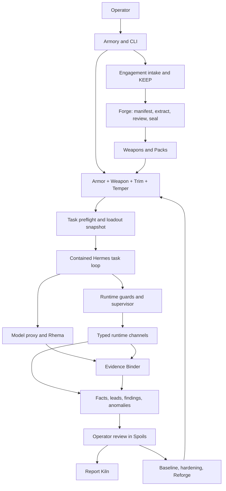
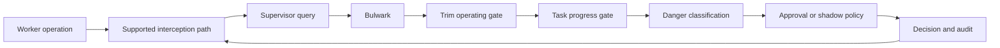

# Architecture

ARA has a control plane, an authoring plane, a runtime plane, and a record plane.
The control plane belongs to the operator.
The authoring plane creates reusable equipment.
The runtime plane mediates supported worker activity.
The record plane preserves evidence and structured results.

## System map



The [source-to-run workflow](end-to-end.md) explains each transition.
The [feature reference](features.md) gives the implementation entry points.

## Operator control plane

Armory uses Python's HTTP server and server-rendered views.
Its main handler routes browser requests to state operations and view functions.
The CLI exposes the same core equipment, Forge, policy, and session modules.

Authentication distinguishes administrator and viewer access.
Browser access can use a token or authenticated cookie.
Unauthenticated page requests go to the login page.
Protected unauthenticated mutation requests receive an unauthorized response.

The control plane provides several working areas:

| Area | Responsibility |
|---|---|
| Armory status | Current loadout, session state, and configuration |
| KEEP | Engagement materials and their manifest |
| Sew | Engagement intake and Trim derivation |
| Forge | Capability creation, coverage, review, and seal |
| Courtyard | Live activity, task progress, approvals, and relationships |
| Rhema | Model traffic, instruction envelope, and shadow comparison |
| Spoils | Findings, leads, facts, dispositions, and focused investigation |
| Equipment pages | Armor, Weapon, Trim, Temper, and Pack inspection |

Legacy page addresses redirect to the current combined working areas.

## Authoring plane

Forge is an explicit phase machine.
A session can create a weapon or a Pack.
It records the selected kind, target identity, predecessor, configuration, phase, and prior equipment.
Its audit log records phase changes.

The pipeline is:

```text
DEPOSIT → MANIFEST → REVIEW → EXHAUST → REVIEW
        → SYNTHESIZE → REVIEW → SEAL → SEALED
```

A deposit records the source file and its identity.
Manifest enumeration creates stable element identifiers from content and material location.
Elements carry text, kind, hash, byte range, and format metadata.
Operator exclusions survive fresh enumeration when their identifiers remain stable.

Extraction channels validate and record structured output against the active manifest.
Synthesis groups the output into a weapon draft or Pack draft.
Pack projection checks typed entries, conflicting values, and foreign-key relationships.
Seal writes the accepted artifacts and seal metadata.

The generated weapon contains the runtime procedure graph and its associated knowledge.
A Pack contains domain definitions selected during capability creation.
The runtime reads the weapon's materialized files.

Implementation: [deposit_mat](../src/ara/forge/phases/deposit.py#L45), [run_manifest](../src/ara/forge/phases/manifest.py#L27), [make_element_id](../src/ara/forge/manifest/element.py#L61), [run_exhaust](../src/ara/forge/loop_driver.py#L292), [run_exhaust_stateless](../src/ara/forge/loop_driver.py#L1017), [record_extraction](../src/ara/forge/phases/exhaust.py#L65), [synthesize](../src/ara/forge/phases/synthesize.py#L223), [project](../src/ara/forge/alphabets/projector.py#L255), [AlphabetPack](../src/ara/forge/alphabets/pack.py#L131), [build_pack_draft](../src/ara/forge/pack_draft.py#L182), [seal_pack](../src/ara/forge/phases/seal.py#L230), [seal](../src/ara/forge/phases/seal.py#L266), [validate_manifest_coverage](../src/ara/forge/phases/seal.py#L107), [validate_citation_integrity](../src/ara/forge/phases/seal.py#L119).

## Equipment composition

The selected armor identifies persistent policy and instruction variants.
Weapon equipment appends marked policy sections to live policy files.
Trim application adds marked engagement sections and its instruction material.
Equipped Tempers add reusable hardening and doctrine.

Markers let release operations remove the relevant section while preserving the standing file.
The ABSOLUTE composer reads the active armor and applicable Temper overlays for each supported request.
Task-specific projections can supply the selected instruction file for a run.

Resource policy watchers can reload changed files.
The weapon's channel graph is installed when the supervisor mounts the engagement.
An active task also checks its loadout hashes.
These mechanisms give equipment selection, policy refresh, and run continuity separate responsibilities.

Implementation: [equip_policy](../src/ara/weapons.py#L209), [unequip_policy](../src/ara/weapons.py#L252), [_maybe_install_engagement](../src/ara/supervisor.py#L1514), [parse_derive_form](../src/ara/armory/trim_views.py#L573), [derive_trim](../src/ara/trims.py#L806), [apply_trim](../src/ara/trims.py#L643), [handle_temper_create](../src/ara/armory/temper_views.py#L498), [handle_temper_tailor_start](../src/ara/armory/temper_views.py#L549), [ingest](../src/ara/tempers.py#L118), [equip](../src/ara/tempers.py#L247), [active_absolute_rule](../src/ara/_rhema_shim.py#L242), [apply_rewrite_spec](../src/ara/_rhema_shim.py#L165), [_try_apply_request_rewrite](../src/ara/mitm_proxy.py#L1594), [record_action](../src/ara/task_session.py#L173), [record_commit](../src/ara/task_session.py#L273), [current_loadout_matches](../src/ara/task_session.py#L415).

## Task startup

Armory's task handler first checks the active equipment and Trim.
It checks permission for active work and the window end when present.
It accepts a first-class equipped Temper or the supported materialized armor-scoped Temper path.

The handler then creates a persistent task record with equipment hashes and action budgets.
It prepares the task's instruction projection and worker command.
Armory selects `hermes` when no worker command is supplied.
The default Hermes path wraps that worker in the persistent task loop.
Claude Code and OpenClaw use explicit integrations.
The handler launches through `ara.cli launch` with the contained task profile.

The launcher prepares a session socket, token, worker directories, guard environment, and model proxy configuration.
It then starts the selected worker.
Session records and task records remain separate, linked by their identifiers and launch metadata.

Implementation: [check_active_trim_for_task](../src/ara/task_preflight.py#L25), [_start_task_session](../src/ara/armory/app.py#L1084), [record_action](../src/ara/task_session.py#L173), [record_commit](../src/ara/task_session.py#L273), [current_loadout_matches](../src/ara/task_session.py#L415), [_build_durable_hermes_worker](../src/ara/armory/app.py#L403), [repair_commit_debt](../src/ara/task_repair.py#L40), [launch](../src/ara/launch.py#L94), [build_contained_env](../src/ara/containment.py#L73).

## Operation control path



Bulwark selects applicable rules by action and scope precedence.
The Trim gate can make a permitted operation more restrictive.
Task state can hold operations while a commit, branch update, or verification is due.
Danger classification adds a separate decision path for recognized hazardous operations.
Approval handling applies the configured operator or automation policy.
The final decision is returned to the interception path and recorded.

The native guard and Node hooks cover different operations.
Node hooks cover supported JavaScript filesystem, process, network, and related calls.
The libc shim covers its supported native wrappers and descendant environment propagation.
Supported Linux launches can use seccomp notification as an additional network decision path.
The launcher screens platform support and attempts installation when containment and the enforcement flag select that path.
An installation or listener attachment failure can leave the run on its other configured guard paths.

Unmatched Bulwark events have an allow default.
The effective posture therefore comes from the selected rules and additional applicable gates.
An armor's shadow mode can record selected would-deny results while permitting the operation.
Routine approval automation and task attestation can also affect a pending approval.

Implementation: [_on_query](../src/ara/supervisor.py#L781), [evaluate](../src/ara/bulwark.py#L820), [evaluate_call](../src/ara/runtime/trim_gate.py#L109), [evaluate_gate](../src/ara/runtime/tod.py#L376), [acquire](../src/ara/runtime/rate_bucket.py#L223), [_shadow_attest_danger](../src/ara/supervisor.py#L1095), [wait_for_resolution](../src/ara/approvals.py#L265).

## Consumer-specific resource boundaries

The supervisor query diagram describes submitted queries.
A native local match or Node local match can decide an operation without that round trip.
The [Control in Depth guide](control-in-depth.md) gives the complete activation and failure behavior for each consumer.

| Consumer | Actual decision point | Default or specific condition |
|---|---|---|
| Native file and exec shim | Match before the real libc call | Matching deny returns `EACCES`; unmatched calls proceed |
| Native network shim | Numeric IP and port before real `connect` | Allow first, deny second; unmatched deny needs `ARA_SHIM_NET_ENFORCE` |
| Installed seccomp filter | Selected syscall notification | Allow first; unmatched IP or read failure denies unless fail-open is enabled |
| Node local filesystem and network hooks | Cached match before original API | Local misses generally proceed; legacy approvals can query |
| Node asynchronous process hooks | Query before original spawn | Nonallow and query failure prevent that spawn |
| Node CommonJS synchronous process hooks | Audit and child environment rewrite | This wrapper does not wait for a policy decision |
| Python task subprocess hook | Query before original `Popen` | Task marker and protocol activate denial on nonallow or transport failure |
| Proxy CONNECT | Rule check before upstream tunnel | Allow first, deny second; unmatched proceeds |
| Typed channel dispatcher | Surface, caller, and schema checks | Reject before channel execution |

General Bulwark queries use deny-first precedence.
Network consumers therefore have a distinct precedence contract.
Native command and network projections omit regular-expression rules and live counter or expiry state.
The native shim retains its handshake rule cache.
Node can receive rule update messages.

The task progress gate counts queried process launches and browser navigation.
It does not count network connections or HTTP requests.
The supplied guard environment disables the retired native raw exec-count channel gate.
Trim evaluation exceptions retain the prior policy decision.
The supervisor does not sleep for the Trim API's returned queue delay.

Contained state redirects HOME, temporary files, and supported profile locations.
It does not create a filesystem namespace or chroot.
Preflight checks equipment and engagement conditions; it does not prove a loaded guard or installed kernel filter.

Sources: [native open](../src/guard/libc_shim/shim.c#L639), [native connect](../src/guard/libc_shim/shim.c#L928), [seccomp activation](../src/ara/launch.py#L447), [Python task gate](../src/ara/clients/sitecustomize.py#L83), [channel checks](../src/ara/supervisor.py#L1549).

## Model interaction path

The proxy handles configured model hosts and supported HTTP formats.
It can examine request and reply rules, apply the selected envelope, and capture interaction records.
Other connections use the proxy's applicable connection policy and tunnel handling.

ABSOLUTE supplies the instruction envelope.
The selected armor can replace the applicable system instructions while preserving configured default sections.
Equipped Temper doctrine is appended to the composition.
A first-class Temper can also append doctrine when no armor envelope exists.

Shadow comparison creates an alternate provider request for observation.
Armor shadow mode is a different control: it changes selected operation deny decisions into recorded permits.
The two mechanisms have separate records and purposes.

Implementation: [active_absolute_rule](../src/ara/_rhema_shim.py#L242), [apply_rewrite_spec](../src/ara/_rhema_shim.py#L165), [_try_apply_request_rewrite](../src/ara/mitm_proxy.py#L1594), [_dispatch_shadow](../src/ara/mitm_proxy.py#L2443), [_on_query](../src/ara/supervisor.py#L781), [add](../src/ara/canary.py#L188), [_check_canaries_in_reply](../src/ara/mitm_proxy.py#L1244), [_try_enforce_bulwark_response](../src/ara/mitm_proxy.py#L1289).

## Typed channel path

A worker sends a channel name and structured body through the session interface.
The supervisor resolves the installed channel and active chunk.
It rejects channels outside the chunk's tool surface.
It also checks task channel debt rules.

Accepted messages receive a channel context with session, activation, caller, and audit information.
The channel checks caller permissions and body fields before execution.
The relevant subsystem writes the resulting record.
Accepted commit channels then update task progress.

The agent caller cannot directly use an operator-only channel through this path.
For example, finding sign-off is an operator action.

Implementation: [emit_tag](../src/ara/runtime/chunks/runtime.py#L202), [_on_channel_call](../src/ara/supervisor.py#L1549), [mint](../src/ara/runtime/activation.py#L56), [_on_query](../src/ara/supervisor.py#L781), [call](../src/ara/runtime/channels/base.py#L90), [FindingSignOffChannel](../src/ara/runtime/findings/channels.py#L486), [validate_for_signoff](../src/ara/runtime/findings/validator.py#L662).

## Record and evidence plane

The Evidence Binder stores content under its SHA-256 hash.
A SQLite index stores source metadata, capture time, activation, summaries, and searchable excerpts.
Tool results, proxy observations, and supported native output paths can contribute captured material.

Facts connect observations to evidence or existing facts.
Leads connect unresolved questions to their investigation history.
Findings connect claims to evidence, impact, remediation, and assets.
Anomaly records connect unexpected evidence to an active procedure and declared shape.

Finding draft checks and sign-off checks serve different stages.
Draft checks can accept incomplete forensic fields while still checking applicable evidence and claim conditions.
Sign-off adds the necessary content requirements before report use.
The Report Kiln reads signed-off findings and writes Markdown with section diagnostics.

Implementation: [put](../src/ara/runtime/binder/api.py#L44), [capture_tool_exchanges](../src/ara/runtime/binder/tool_capture.py#L108), [_capture_evidence](../src/ara/mitm_proxy.py#L2396), [FactAssertChannel](../src/ara/runtime/facts/channels.py#L68), [enrich_evidence](../src/ara/runtime/provenance.py#L84), [NeighborIndex](../src/ara/runtime/facts/neighbors.py#L29), [compute_priority](../src/ara/runtime/leads/priority.py#L57), [retrievability](../src/ara/runtime/leads/decay.py#L53), [check_closure](../src/ara/runtime/leads/closure_gate.py#L26), [on_evidence](../src/ara/runtime/anomaly/autofire.py#L79), [compute_divergence](../src/ara/runtime/anomaly/divergence.py#L30), [FindingFileChannel](../src/ara/runtime/findings/channels.py#L333), [_rule_claim_verification](../src/ara/runtime/findings/validator.py#L367), [record_finding_fields](../src/ara/runtime/findings/field_store.py#L75), [FindingSignOffChannel](../src/ara/runtime/findings/channels.py#L486), [validate_for_signoff](../src/ara/runtime/findings/validator.py#L662), [ReportRenderChannel](../src/ara/runtime/report/channels.py#L25), [render_report](../src/ara/runtime/report/kiln.py#L119), [StyleScoreChannel](../src/ara/runtime/style/channels.py#L21).

## State layout

```text
<state-root>/
  active-armor                 selected persistent identity
  equipped_weapon              selected sealed method
  active-tempers               equipped hardening packages
  bulwark.md                   live resource policy
  armors/<armor>/              identity, variants, trims, classic Temper state
  tempers/<temper>/policy/     first-class hardening material
  engagements/<id>/            intake, material classes, manifest
  forge/<id>/                  authoring session, manifest, extraction, draft
  runtime-packs/               operator-created domain definitions
  weapons/<id>/                sealed method, chunks, alphabets, search, seal
  task-runs/<id>/              task state, projection, deadline, audit
  sessions/<id>/               worker state, records, evidence, transcript
  task-launches/               task launcher markers and logs
```

The [codex](codex.md) explains which component reads and writes each major record.
The [configuration guide](configuration.md) explains state directory selection and runtime settings.

## Integration surfaces

Hermes supplies the default persistent task worker.
Claude Code and OpenClaw have dedicated launch adapters.
A generic launcher can supervise another executable.
The available interception and model paths depend on that worker's integration.

The Forge and Temper MCP servers expose structured authoring tools.
Worker SDK and IPC paths expose session channel operations.
Optional style, knowledge-gap, and other substrate APIs can be installed by an integration.
Their presence as source modules does not install them in every launch path.

Implementation: [_build_durable_hermes_worker](../src/ara/armory/app.py#L403), [_start_task_session](../src/ara/armory/app.py#L1084), [repair_commit_debt](../src/ara/task_repair.py#L40), [launch](../src/ara/launch.py#L94), [build_contained_env](../src/ara/containment.py#L73), [call_tool](../src/ara/clients/temper_mcp_server.py#L514), [_validate_tailor_candidate](../src/ara/temper_lifecycle.py#L195), [add_tailor_coverage_summary](../src/ara/temper_lifecycle.py#L594), [validate_control](../src/ara/temper_controls.py#L153), [CrumbIntentChannel](../src/ara/runtime/chunks/crumb_intent.py#L58), [has_sufficient_coverage](../src/ara/runtime/knowledge_gap.py#L58), [install_engagement](../src/ara/runtime/bootstrap.py#L175), [ReportRenderChannel](../src/ara/runtime/report/channels.py#L25), [render_report](../src/ara/runtime/report/kiln.py#L119), [StyleScoreChannel](../src/ara/runtime/style/channels.py#L21).
